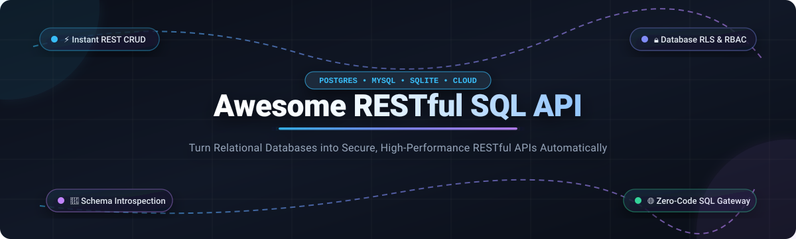

  

# 🚀 Awesome RESTful SQL API

  
  
  
  

> 📚 A curated directory of leading SaaS products, DBaaS data APIs, and open-source SQL-to-REST gateways for auto-generating secure CRUD endpoints, GraphQL layers, and data APIs directly from SQL database schemas.

Auto-generated RESTful SQL APIs turn database schemas directly into secure, production-ready web endpoints—handling HTTP verbs, filtering, pagination, foreign-key relations, authentication, and database-level row security (RLS) without requiring repetitive boilerplate backend code. ⚡

---

## 📑 Table of Contents

- [📊 Sector Overview & Market Dynamics](#-sector-overview--market-dynamics)
- [☁️ SaaS & Managed Platforms](#️-saas--managed-platforms)
- [💻 Open-Source GitHub Projects](#-open-source-github-projects)
- [🏗️ Architecture & Trade-offs Guide](#️-architecture--trade-offs-guide)
- [🤝 How to Contribute](#-how-to-contribute)
- [💖 Support](#-support)
- [⭐ Star History](#-star-history)
- [⚠️ Disclaimer](#️-disclaimer)

---

## 📊 Sector Overview & Market Dynamics

The RESTful SQL API and automated data layer ecosystem forms an essential subsegment bridging the **Database-as-a-Service (DBaaS)** market (estimated at **$30.5B–$42.9B** and projected to surpass **$112B+**) and the **API Management** market (valued at **~$8B–$10B** growing toward **$37B+**). Market dynamics exhibit a **moderately fragmented, bifurcated structure**: hyperscale cloud providers and multi-billion-dollar data platforms (AWS, Snowflake, ClickHouse) dominate proprietary analytical and query execution APIs, while high-growth developer platforms (Supabase, Directus, Hasura) and modular open-source gateways (PostgREST, Faucet) capture transactional and multi-database application workloads without a single winner-take-all monopoly. 🌐

---

## ☁️ SaaS & Managed Platforms

The following hosted platforms and cloud services provide auto-generated REST/HTTP interfaces, query execution APIs, or managed data gateways over relational data stores. Entries are ordered descending by company market capitalization or valuation. 📈

| Product / Platform | 🏢 Company Valuation / Scale | 💳 Starting Tier Pricing | 🎁 Free Tier Limits / Free Trial | 🛠️ Key Features & Best Use Case |
| :--- | :--- | :--- | :--- | :--- |
| **[AWS Data API for Aurora](https://docs.aws.amazon.com/AmazonRDS/latest/AuroraUserGuide/data-api.html)** | **~$2.6T Market Cap** (Amazon parent; AWS run-rate ~$184B) | Pay-as-you-go at **$0.35 per 1M requests** (metered in 32 KB increments) | **1M requests/month free** (AWS Free Tier for 12 months) | Serverless HTTP querying for Amazon Aurora without persistent TCP connection pooling overhead. |
| **[Snowflake SQL API](https://docs.snowflake.com/en/developer-guide/sql-api/about-endpoints)** | **~$110B–$117B Market Cap** (Public: NYSE: SNOW) | Standard Edition starting at **$2.00 per credit** (billed by second, 60s min) | **30-day free trial** with **$400 in free usage credits** | REST API (`/api/v2/statements/`) for submitting asynchronous/synchronous SQL jobs to Snowflake data warehouses. |
| **[ClickHouse Cloud](https://clickhouse.com/)** | **$15.0B Valuation** (Series D, ARR $250M+) | Basic Tier starting at **~$0.125 per compute unit/hr** (billed per minute) | **30-day free trial** with **$300 in free usage credits** | Native high-throughput HTTP interface on port 8123/8443 for real-time analytical SQL queries. |
| **[Supabase REST API](https://supabase.com/docs/guides/api)** | **$10.5B Valuation** (Series F) | Pro Tier starting at **$25/month** per organization / project | **Free Tier forever**: 2 active projects, 500 MB database storage, 5 GB bandwidth, 50,000 MAU | Auto-generated RESTful API powered by PostgREST with Postgres Row Level Security (RLS) and auth. |
| **[Hasura Cloud](https://hasura.io/)** | **$1.0B Valuation** (Series C) | Professional Tier starting at **$1.50/hour active** (pay-as-you-go) | **Free Tier forever**: Up to 3 projects, 3M API requests/month, 100 MB data passthrough, 2 connectors | Instant GraphQL/REST engine connecting databases with role-based authorization and caching. |
| **[SingleStore Helios Data API](https://docs.singlestore.com/)** | **~$940M Valuation** (PE buyout via Vector Capital) | Standard Edition starting at **$0.99/hour** (0.25 credits/hr at $3.96/credit) | **Free Shared Tier forever**: Up to 1 GB compressed storage, shared compute, 1 attached database | Built-in HTTP server (`/query/rows`) for executing SQL statements via JSON POST requests. |
| **[Prisma Accelerate](https://www.prisma.io/)** | **~$300M Valuation** (Series B, $56.5M raised) | Starter Plan starting at **$10/month** (includes 1M operations) | **Free Tier forever**: Up to 60,000 operations/month and global edge caching proxy | Managed connection pooling and global edge-caching proxy for Prisma queries across ~280 locations. |
| **[Cube Cloud](https://cube.dev/)** | **~$150M–$200M Valuation** (Series B, $47M raised) | Starter Tier starting at **$40/developer/month** + CCU resource usage | **Free Tier forever**: Up to 2 shared deployment apps with capped monthly AI/query tokens | Universal semantic layer providing SQL and REST APIs over data warehouses for embedded analytics. |
| **[SurrealDB Cloud](https://surrealdb.com/)** | **~$120M–$150M Valuation** (Series A, $44M raised) | "Start" Tier pay-as-you-go starting at **$0.021/hour** (~$15/month) | **Free Tier forever**: 1 free instance, 1 GB storage included (auto-pauses after 7 days inactivity) | Multi-model database cloud with built-in HTTP query endpoint (`/sql`) executing SurrealQL statements. |

---

## 💻 Open-Source GitHub Projects

Curated open-source SQL-to-REST engines, instant backend generators, and database HTTP gateways. Sorted descending by repository GitHub Stars_Count. 🌟

| Project | ⭐ GitHub_Stars | 💻 Language | 📜 License | 🎯 Primary Focus & Architecture |
| :--- | :--- | :--- | :--- | :--- |
| **[Supabase](https://github.com/supabase/supabase)** |  | TypeScript / Elixir | Apache 2.0 | Complete open-source Firebase alternative embedding PostgREST, GoTrue authentication, Supavisor pooling, and Realtime Postgres listening. |
| **[NocoDB](https://github.com/nocodb/nocodb)** |  | TypeScript | AGPL 3.0 | Open-source Airtable alternative that connects to MySQL, PostgreSQL, SQL Server, and SQLite to generate instant REST APIs and smart spreadsheet views. |
| **[PocketBase](https://github.com/pocketbase/pocketbase)** |  | Go | MIT | Lightweight single-file Go binary combining embedded SQLite with auto-generated realtime REST APIs, file storage, and an administration dashboard. |
| **[Directus](https://github.com/directus/directus)** |  | TypeScript | BSL 1.1 / Apache 2.0 | Real-time REST and GraphQL data engine layered dynamically over existing SQL schemas (PostgreSQL, MySQL, SQLite, Oracle, MariaDB). |
| **[Hasura GraphQL Engine](https://github.com/hasura/graphql-engine)** |  | Haskell | Apache 2.0 | Ultra-fast engine that introspects databases (Postgres, SQL Server, BigQuery, Snowflake) to generate GraphQL and REST endpoints with granular RBAC. |
| **[PostgREST](https://github.com/PostgREST/postgrest)** |  | Haskell | MIT | The pioneering, battle-tested standard for PostgreSQL-to-REST; maps tables, views, and functions into clean RESTful endpoints using database roles and RLS. |
| **[Cube Core](https://github.com/cube-js/cube)** |  | Rust / TypeScript | Apache 2.0 | Semantic data modeling layer that exposes analytical data warehouses via both standard SQL and REST APIs for BI and application developers. |
| **[pREST](https://github.com/prest/prest)** |  | Go | MIT | High-performance Go daemon that serves a RESTful API from any PostgreSQL database, supporting custom SQL templates and JWT authentication. |
| **[PHP-CRUD-API](https://github.com/mevdschee/php-crud-api)** |  | PHP | MIT | Single-file script that provides a complete OpenAPI-documented RESTful API for MySQL, PostgreSQL, SQL Server, and SQLite schemas. |
| **[DreamFactory](https://github.com/dreamfactorysoftware/dreamfactory)** |  | PHP | Apache 2.0 | Enterprise API management platform that connects to any relational SQL database, auto-generates comprehensive REST APIs, and enforces granular role security. |
| **[subZero PostgREST Starter Kit](https://github.com/subzerocloud/postgrest-starter-kit)** |  | Shell / Lua | Apache 2.0 | Production-ready boilerplate bundling PostgREST, OpenResty/Nginx, PostgreSQL, and background worker queues for full-stack API development. |
| **[pgrest](https://github.com/pgrest/pgrest)** |  | JavaScript | MIT | Node.js / Express middleware and gateway converting incoming HTTP REST calls into parameterized PostgreSQL SQL queries. |
| **[Faucet](https://github.com/faucetdb/faucet)** |  | Go | MIT | Modern multi-database REST API generator in a ~22MB Go binary supporting 7 engines (Postgres, MySQL, MariaDB, SQL Server, Oracle, Snowflake, SQLite) with an embedded MCP server. |

---

## 🏗️ Architecture & Trade-offs Guide

When selecting between automated SQL-to-REST solutions, consider four primary architecture paradigms: 🔍

1. **🔒 Database-Native Declarative Gateways (PostgREST, pREST)**
   * *Best for:* Teams heavily invested in PostgreSQL using native Row Level Security (RLS) and stored procedures.
   * *Trade-off:* Database-specific; requires database administrators comfortable writing SQL security grants rather than application-layer middleware.
2. **🔌 Multi-Database API Engines (Faucet, Directus, DreamFactory)**
   * *Best for:* Heterogeneous environments spanning MySQL, PostgreSQL, SQL Server, and Oracle.
   * *Trade-off:* Application-layer authorization models must be synchronized across disparate database tables.
3. **⚡ Batteries-Included BaaS / App Platforms (Supabase, PocketBase, NocoDB)**
   * *Best for:* Rapid full-stack application prototyping, mobile backends, and internal spreadsheet-like tools.
   * *Trade-off:* Couples database access with ancillary services (authentication, file storage, webhooks).
4. **☁️ Cloud Warehouse & Analytics HTTP APIs (Snowflake SQL API, ClickHouse HTTP, AWS Data API)**
   * *Best for:* Serverless lambdas, ETL pipelines, and reporting dashboards that need stateless query execution without persistent DB connections.
   * *Trade-off:* Designed for query execution and ingestion rather than end-user CRUD application endpoints.

---

## 🤝 How to Contribute

1. Fork this repository. 🍴
2. Add or update entries in `README.md` following the tabular schema. 📝
3. Verify that all repository Stars_Counts, pricing figures, and links are accurate and up-to-date. ✅
4. Submit a Pull Request with a clear description of changes. 🚀

---

## 💖 Support

Thank you for exploring this curated guide to the RESTful SQL API ecosystem! 🙏 If you found this repository helpful:

- ⭐ **Star this repository** to help others discover it!
- 🍴 **Fork and share** it with your fellow engineers, data platform teams, and architects.
- ☕ **Buy me a coffee & support ongoing curation**: Consider sponsoring the project via the [GitHub Sponsors Dashboard](https://github.com/sponsors/ishandutta2007) to help maintain and keep this ecosystem map up to date!

---

## 📈 Star History

---

## ⚠️ Disclaimer

- This list is community-curated for informational and architectural evaluation purposes.
- Exposing databases directly via HTTP endpoints requires rigorous attention to authentication, SQL injection guards, rate limiting, and Row-Level Security (RLS). Always test access controls thoroughly before production deployment.
- Verify license compliance and cloud pricing terms directly on each provider's official portal.
